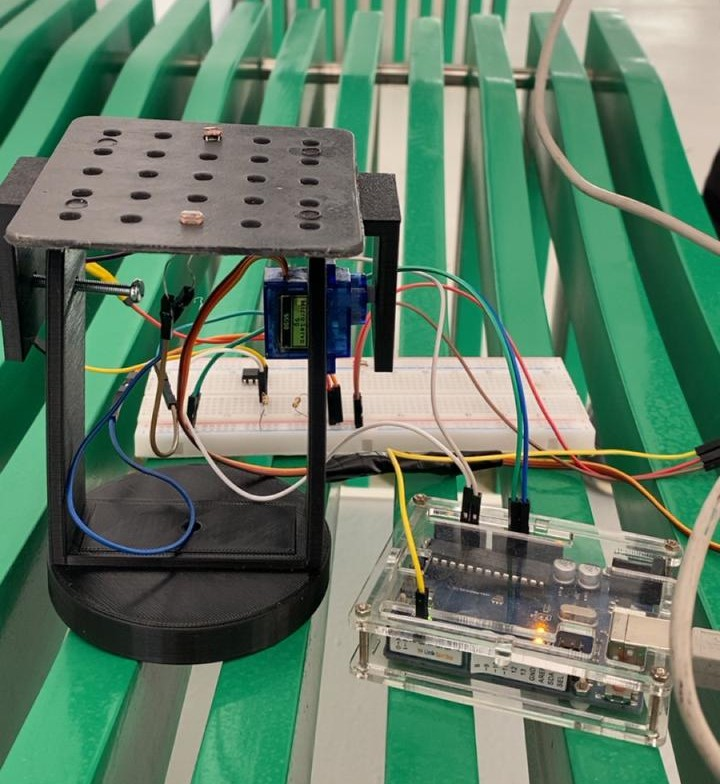
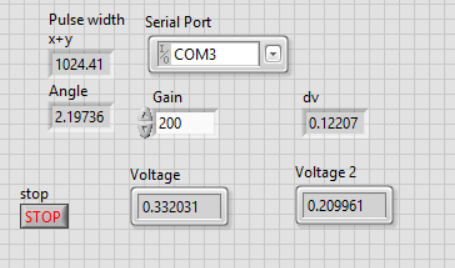
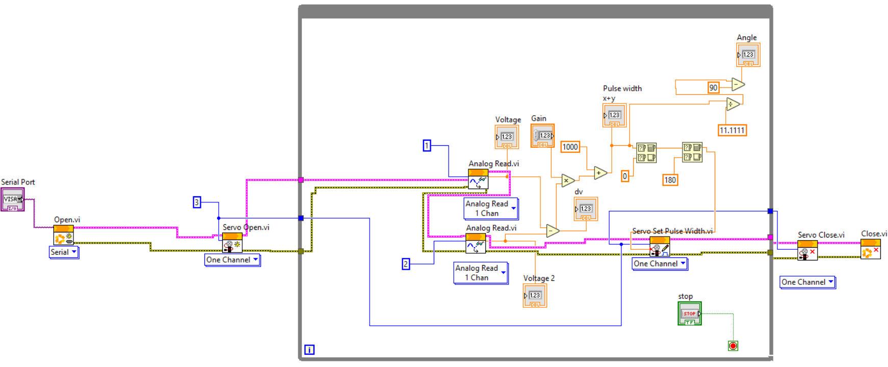
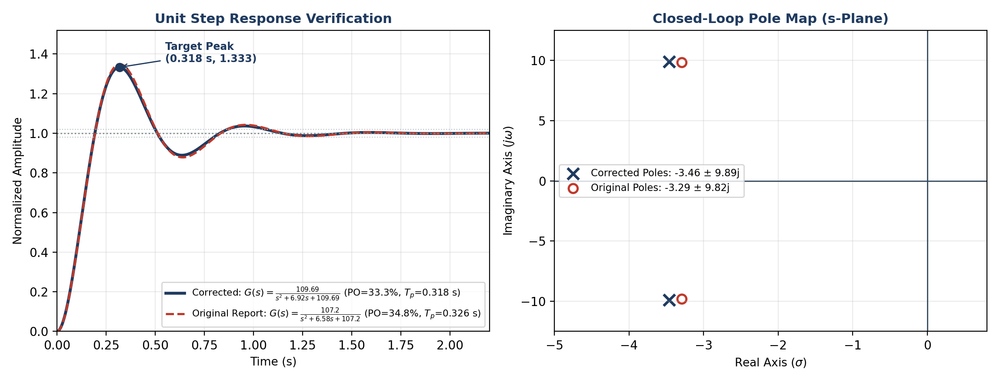

# Automatic Light Tracking System (LDR–Servo, LabVIEW & Arduino)

A closed-loop single-axis solar/light tracking system built with two **LDR (photoresistor)** sensors, an **Arduino UNO**, a **TowerPro SG90 9g micro servo**, and **LabVIEW** (using the **LINX** toolkit over `COM3` serial) to continuously align a tilt platform toward the brightest light source.

## Hardware Setup & Pinout

| Component | Arduino UNO Pin | Notes |
|---|---|---|
| **LDR 1** (Voltage divider) | `A1` | Primary light sensor (`Analog Read 1 Chan`) |
| **LDR 2** (Voltage divider) | `A2` | Secondary light sensor (`Analog Read 1 Chan`) |
| **SG90 9g Micro Servo** | `D3` | PWM signal via LINX `Servo Set Pulse Width.vi` |
| **Power Rail** | `5V` / `GND` | Shared 5V and common ground across sensors and servo |
| **PC Interface** | USB (`COM3`) | Real-time serial telemetry to LabVIEW LINX |

## LabVIEW Implementation

### Front Panel & Block Diagram

## Corrected Mathematical Model & Transfer Function

### 1. Differential Voltage-to-Angle & Servo PWM Mapping
For a symmetric two-LDR differential voltage range $\Delta V = V_1 - V_2 \in [-0.9\text{ V},\ +0.9\text{ V}]$ centered at midday ($\theta_0 = 90^\circ$):

$$\theta = \operatorname{clamp}\!\left(K \cdot \Delta V + 90^\circ,\ 0^\circ,\ 180^\circ\right), \quad K = \frac{90^\circ}{0.9\text{ V}} = 100^\circ/\text{V}$$

For an **SG90** micro servo ($500\text{--}2500\,\mu\text{s}$ across $0^\circ\text{--}180^\circ$, midpoint $1500\,\mu\text{s} = 90^\circ$):

$$\text{Pulse Width }(\mu\text{s}) = 500 + \frac{2000}{180}\,\theta \approx 500 + 11.1111\,\theta$$

### 2. Second-Order System Identification
From experimental step-response specifications ($\text{PO} = 33.3\%$, peak time $T_p = 0.3178\text{ s}$):

| Parameter | Formula | Original Report | Corrected Value |
|---|---|---|---|
| **Damping Ratio ($\zeta$)** | $\frac{-\ln(\text{PO}/100)}{\sqrt{\pi^2 + \ln^2(\text{PO}/100)}}$ | $0.3178$ *(error)* | **$0.3304$** |
| **Damped Frequency ($\omega_d$)** | $\frac{\pi}{T_p}$ | $9.88\text{ rad/s}$ | **$9.885\text{ rad/s}$** |
| **Natural Frequency ($\omega_n$)** | $\frac{\omega_d}{\sqrt{1 - \zeta^2}}$ | $10.35\text{ rad/s}$ | **$10.473\text{ rad/s}$** |
| **Closed-Loop Poles** | $-\zeta\omega_n \pm j\omega_d$ | $-3.29 \pm 9.82j$ | **$-3.46 \pm 9.89j$** |
| **Settling Time ($T_s$, 2%)** | $\frac{4}{\zeta\omega_n}$ | $1.365\text{ s}$ | **$1.156\text{ s}$** |
| **Transfer Function $G(s)$** | $\frac{\omega_n^2}{s^2 + 2\zeta\omega_n s + \omega_n^2}$ | $\frac{107.2}{s^2 + 6.58s + 107.2}$ | **$\frac{109.69}{s^2 + 6.92s + 109.69}$** |

### Key Engineering Corrections Over Original Course Report
1. **Transfer Function Fit:** The original report omitted the minus sign in the $\zeta$ equation and reused $T_p = 0.3178$ as $\zeta$, causing LabVIEW's simulated step response to produce $34.83\%$ overshoot and $T_p = 0.326\text{ s}$ instead of the target $33.3\%$ and $0.3178\text{ s}$.
2. **Gain & Clamping:** Reduced symmetric gain from $200^\circ/\text{V}$ (which saturates past $180^\circ$) to $100^\circ/\text{V}$, and noted that `Servo Set Pulse Width.vi` expects pulse width clamped to $[500, 2500]\,\mu\text{s}$ rather than $[0, 180]$ degrees.
3. **Block Diagram Topology:** Corrected the unity-feedback loop so $G(s)$ sits in the forward path rather than the feedback path.

## Repository Structure
- `images/` — Hardware prototype photo, LabVIEW front panel & block diagrams, and step-response verification plot.
- `labview/` — Original LabVIEW VIs (`project 1.vi`, `servo test1.vi`, `Step Response.vi`).
- `docs/` — Original course report (`final_control_original.pdf`).
- `simulate_step_response.py` — Python verification script reproducing all control metrics and plots.

## Team & Supervision
- **Course Project:** Automatic Control Systems — Mechatronics Engineering, Egypt-Japan University for Science and Technology (E-JUST), May 2025
- **Team Members:** [Mahmoud A. Mohamed](https://github.com/MamoudAlaa), Shahd Mohamed Ali, Aya Gamal, Adham Yasser
- **Supervisor:** Prof. Ayman Nada
